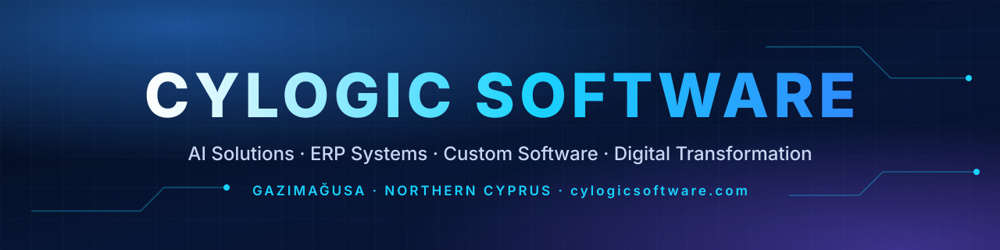

<div align="center">

<a href="https://www.cylogicsoftware.com/"></a>

<br>

<a href="https://www.cylogicsoftware.com/"></a>

# CYLOGIC SOFTWARE

**AI Solutions · ERP Systems · Custom Software Development · Digital Transformation**

<a href="https://www.cylogicsoftware.com/"></a>
<a href="https://cylogicsoftware.github.io/cylogicsoftware-official/"></a>
<a href="mailto:info@cylogicsoftware.com"></a>

<a href="https://www.linkedin.com/company/cylogicsoftware/"></a>
<a href="https://www.instagram.com/cylogicsoftwareofficall/"></a>
<a href="https://www.facebook.com/profile.php?id=61596032317881"></a>
<a href="https://x.com/cylogicsoftware"></a>
<a href="https://www.pinterest.com/cylogicsoftware/"></a>
<a href="https://github.com/cylogicsoftware"></a>

<br><br>

**🇹🇷 [Türkçe](#-türkçe) · 🇬🇧 [English](#-english) · 🇷🇺 [Русский](#-русский) · 🇮🇷 [فارسی](#-فارسی)**

</div>

---

## 🇹🇷 Türkçe

**Cy Logic Software**, Kuzey Kıbrıs ve Türkiye'deki işletmeler için özel yazılım, kurumsal ERP sistemleri, yapay zekâ çözümleri ve güvenli BT altyapısı geliştiren, Gazimağusa merkezli bir teknoloji şirketidir. Bir web ajansından fazlası olarak; yazılım, otomasyon ve dijital dönüşüm ihtiyaçlarını uçtan uca karşılayan bir teknoloji ortağıyız.

| | Hizmet alanı | Kapsam |
|:-:|---|---|
| 🤖 | **Yapay Zekâ** | Yapay zekâ destekli iş çözümleri, entegrasyon, asistanlar ve ajanlar, yerel LLM ve RAG, raporlama ve veri analizi |
| 📊 | **ERP ve Kurumsal Yazılım** | Özel ERP, finans yönetimi, muhasebe ve raporlama, stok yönetimi, insan kaynakları ve puantaj, CRM |
| 💻 | **Özel Yazılım Geliştirme** | Kurumsal web uygulamaları, React ve TypeScript, veritabanı tabanlı sistemler, web/mobil/SaaS, B2B platformlar |
| ⚙️ | **İş Otomasyonu ve Entegrasyon** | Süreç otomasyonu, API ve sistem entegrasyonları, dashboard ve iş zekâsı |
| 🛡️ | **BT Altyapısı ve Dijital Dönüşüm** | Sunucu ve bulut altyapısı, yedekleme ve izleme, siber güvenlik, işletmelerin dijitalleşmesi |

🌐 Resmî web sitesi: **[www.cylogicsoftware.com](https://www.cylogicsoftware.com/tr)** · ✉️ [info@cylogicsoftware.com](mailto:info@cylogicsoftware.com) · 📍 Gazimağusa, KKTC

<p align="right"><a href="#cylogic-software">⬆ Başa dön</a></p>

## 🇬🇧 English

**Cy Logic Software** is a Famagusta-based technology company building custom software, enterprise ERP systems, AI solutions and secure IT infrastructure for businesses in Northern Cyprus and Türkiye. More than a web agency, we are a technology partner covering software, automation and digital transformation end to end.

| | Service area | Scope |
|:-:|---|---|
| 🤖 | **Artificial Intelligence** | AI-powered business solutions, AI integration, assistants & agents, local LLM and RAG, AI reporting & data analysis |
| 📊 | **ERP & Enterprise Software** | Custom ERP, financial management, accounting & reporting, inventory, HR and time & attendance, CRM |
| 💻 | **Custom Software Development** | Enterprise web apps, React & TypeScript, database-driven systems, web/mobile/SaaS, B2B platforms |
| ⚙️ | **Business Automation & Integration** | Process automation, API and system integrations, dashboards & business intelligence |
| 🛡️ | **IT & Digital Transformation** | Server & cloud infrastructure, backup & monitoring, cybersecurity, business digitalization |

🌐 Official website: **[www.cylogicsoftware.com](https://www.cylogicsoftware.com/en)** · ✉️ [info@cylogicsoftware.com](mailto:info@cylogicsoftware.com) · 📍 Famagusta, Northern Cyprus

<p align="right"><a href="#cylogic-software">⬆ Back to top</a></p>

## 🇷🇺 Русский

**Cy Logic Software** — технологическая компания из Фамагусты, которая создаёт заказное программное обеспечение, корпоративные ERP-системы, решения на базе искусственного интеллекта и надёжную ИТ-инфраструктуру для бизнеса на Северном Кипре и в Турции. Мы больше, чем веб-студия: мы технологический партнёр, ведущий проекты по разработке ПО, автоматизации и цифровой трансформации от начала до конца.

| | Направление | Что входит |
|:-:|---|---|
| 🤖 | **Искусственный интеллект** | Бизнес-решения на базе ИИ, интеграция ИИ, ассистенты и агенты, локальные LLM и RAG, аналитика данных |
| 📊 | **ERP и корпоративное ПО** | ERP на заказ, финансовое управление, учёт и отчётность, склад, управление персоналом, CRM |
| 💻 | **Разработка ПО на заказ** | Корпоративные веб-приложения, React и TypeScript, системы на базе БД, веб/мобильные/SaaS, B2B-платформы |
| ⚙️ | **Автоматизация и интеграция** | Автоматизация процессов, API и системная интеграция, дашборды и BI |
| 🛡️ | **ИТ и цифровая трансформация** | Серверная и облачная инфраструктура, резервное копирование и мониторинг, кибербезопасность, цифровизация |

🌐 Официальный сайт: **[www.cylogicsoftware.com](https://www.cylogicsoftware.com/ru)** · ✉️ [info@cylogicsoftware.com](mailto:info@cylogicsoftware.com) · 📍 Фамагуста, Северный Кипр

<p align="right"><a href="#cylogic-software">⬆ Наверх</a></p>

## 🇮🇷 فارسی

<div dir="rtl" align="right">

**Cy Logic Software** یک شرکت فناوری مستقر در فاماگوستا است که برای کسب‌وکارهای قبرس شمالی و ترکیه نرم‌افزار سفارشی، سیستم‌های ERP سازمانی، راهکارهای هوش مصنوعی و زیرساخت امن فناوری اطلاعات طراحی و پیاده‌سازی می‌کند. ما فراتر از یک آژانس وب، شریک فناوری‌ای هستیم که نیازهای نرم‌افزاری، اتوماسیون و تحول دیجیتال را از ابتدا تا انتها پوشش می‌دهد.

<table dir="rtl">
<tr><th></th><th align="right">حوزه خدمات</th><th align="right">دامنه</th></tr>
<tr><td>🤖</td><td align="right"><b>هوش مصنوعی</b></td><td align="right">راهکارهای کسب‌وکار مبتنی بر هوش مصنوعی، یکپارچه‌سازی، دستیارها و عامل‌های هوشمند، LLM محلی و RAG، تحلیل داده</td></tr>
<tr><td>📊</td><td align="right"><b>ERP و نرم‌افزار سازمانی</b></td><td align="right">ERP سفارشی، مدیریت مالی، حسابداری و گزارش‌دهی، انبار، منابع انسانی و حضور و غیاب، CRM</td></tr>
<tr><td>💻</td><td align="right"><b>توسعه نرم‌افزار سفارشی</b></td><td align="right">برنامه‌های وب سازمانی، React و TypeScript، سیستم‌های مبتنی بر پایگاه داده، وب/موبایل/SaaS، پلتفرم‌های B2B</td></tr>
<tr><td>⚙️</td><td align="right"><b>اتوماسیون و یکپارچه‌سازی</b></td><td align="right">اتوماسیون فرایندها، یکپارچه‌سازی API و سیستم‌ها، داشبورد و هوش تجاری</td></tr>
<tr><td>🛡️</td><td align="right"><b>فناوری اطلاعات و تحول دیجیتال</b></td><td align="right">زیرساخت سرور و ابر، پشتیبان‌گیری و پایش، امنیت سایبری، دیجیتالی‌سازی کسب‌وکار</td></tr>
</table>

🌐 وب‌سایت رسمی: <b><a href="https://www.cylogicsoftware.com/fa">www.cylogicsoftware.com</a></b> · ✉️ <a href="mailto:info@cylogicsoftware.com">info@cylogicsoftware.com</a> · 📍 فاماگوستا، قبرس شمالی

<p align="left"><a href="#cylogic-software">⬆ بازگشت به بالا</a></p>

</div>

---

## 🧰 Technologies

<div align="center">


<sub>Technologies as listed on <a href="https://www.cylogicsoftware.com/tr/teknolojiler">cylogicsoftware.com/teknolojiler</a>.</sub>

</div>

## 🌐 Official Website & Profiles

| Platform | Profile |
|---|---|
| 🌐 Website | [www.cylogicsoftware.com](https://www.cylogicsoftware.com/) |
| 🚀 Digital Identity Hub | [cylogicsoftware.github.io/cylogicsoftware-official](https://cylogicsoftware.github.io/cylogicsoftware-official/) |
| LinkedIn | [Cy Logic Software](https://www.linkedin.com/company/cylogicsoftware/) |
| Instagram | [@cylogicsoftwareofficall](https://www.instagram.com/cylogicsoftwareofficall/) |
| Facebook | [Cy Logic Software](https://www.facebook.com/profile.php?id=61596032317881) |
| X (Twitter) | [@cylogicsoftware](https://x.com/cylogicsoftware) |
| Pinterest | [@cylogicsoftware](https://www.pinterest.com/cylogicsoftware/) |
| GitHub | [@cylogicsoftware](https://github.com/cylogicsoftware) |
| ✉️ Email | [info@cylogicsoftware.com](mailto:info@cylogicsoftware.com) |

<sub>Only verified official accounts are listed. The source of truth is <a href="data/social-links.json"><code>data/social-links.json</code></a>.</sub>

## 🗂️ Repository

```text
├── index.html, en/, ru/, fa/   Pre-rendered pages (generated by scripts/build.py)
├── locales/                    tr.json · en.json · ru.json · fa.json
├── data/social-links.json      Verified official profiles
├── assets/                     css · js · images · icons
├── scripts/build.py            Zero-dependency static page generator
├── docs/maintenance.md         How to update content, languages and profiles
├── robots.txt · sitemap.xml · llms.txt
└── .github/workflows/deploy.yml  Auto-deploys to GitHub Pages on push to main
```

See [docs/maintenance.md](docs/maintenance.md) for update instructions.

## 📄 License

The original source code in this repository is released under the [MIT License](LICENSE). The CYLOGIC SOFTWARE name, logo and brand assets are **not** covered by this license and remain the property of Cy Logic Software. Platform icons are from [Simple Icons](https://simpleicons.org/) (CC0); the respective trademarks belong to their owners.

<div align="center">
<br>
<sub>© 2026 Cy Logic Software · Gazimağusa, KKTC · <a href="https://www.cylogicsoftware.com/">cylogicsoftware.com</a></sub>
</div>
